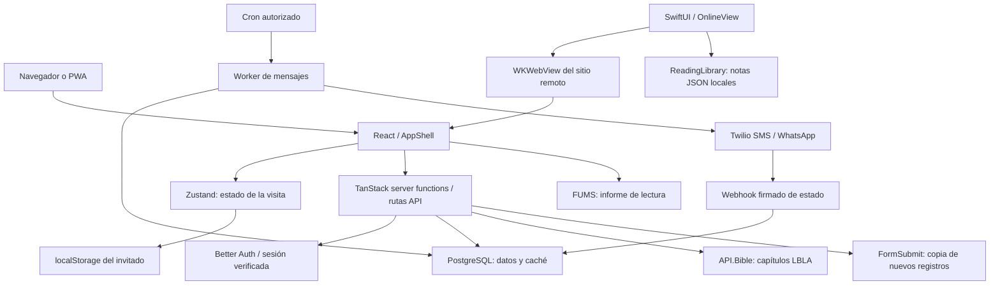

# Arquitectura de The Preacher

Estado y alcance: [contexto técnico](contexto-tecnico.md).

## Capas y límites

El diagrama muestra dependencias; no implica que cada proveedor esté configurado en el despliegue. La clave bíblica y credenciales de mensajería residen en el servidor. El cliente sí carga el script FUMS documentado; es un flujo distinto al de descarga del capítulo.

## Entrada y navegación

`src/router.tsx` crea el router; `routes/__root.tsx` monta el documento, proveedor de autenticación y bridge del entorno. `routes/index.tsx` abre `AppShell`. Las secciones Hoy/Biblia/Temas/Gente/Doctrina/Guardados/Admin son estado React dentro de `/`, no rutas URL independientes. Recargar vuelve a Hoy; la posición bíblica se conserva aparte.

`AppShell` coordina sesión, sincronización, idioma, tema seleccionado, diálogo de envío, perfil, ajustes, pregunta y saltos a una referencia. Abre páginas completas para login, privacidad, términos y soporte. El salto desde una referencia usa `BibleJump` con `at` para identificar una nueva selección.

La interfaz usa Tailwind 4, Radix y componentes propios. Los tokens están en `src/styles.css`: paleta clara/oscura, Figtree/Newsreader, tamaño del lector y movimiento. El contenedor principal es `max-w-lg`; la navegación inferior fija contempla safe areas. `panel-focus.ts`, `use-dialog-focus.ts`, `confirm-dialog.tsx` y `tab-keys.ts` soportan foco y teclado. Cambiar diseño no autoriza quitar esos comportamientos.

## Módulos

| Área | Entradas | Responsabilidad |
| --- | --- | --- |
| Catálogo | `lib/verses.ts`, `bible.ts`, `verses-en.ts` | Libros, referencias, 16 temas, selección diaria, nombres bilingües |
| Lectura | `lib/recobro.ts`, `api-bible*.ts`, `components/use-hydrated-verse.ts` | Resolver referencias, cargar, validar, cachear y atribuir capítulos |
| Editorial | `doctrine.ts`, `preach-cases.ts`, `evangelism.ts` | Doctrina, casos y guías; la postura editorial es contenido del producto |
| Estado | `store.ts`, `cloud-sync.tsx`, `cloud-saver.ts`, `user-state*.ts` | Preferencias, favoritos, destinatarios y sincronización |
| Identidad | `lib/auth/*`, `sign-in-panel.tsx`, `delete-account-panel.tsx` | Sesiones, OAuth, preview, salida y eliminación |
| Personas | `people-preach-view.tsx`, `church.ts`, `preach-schedule.ts` | Agenda personal, temas, iglesia y recordatorios manuales |
| Automatización | `message-schedules.ts`, `messaging/*`, `api/cron/messages.ts` | Persistencia, reserva, envío y resultados |
| Administración | `admin.ts`, `roles.server.ts`, `admin-shape.ts`, `admin-notes.ts`, `theme-verses.ts` | Roles, registros, cuentas y herramientas editoriales |
| Registro público | `contacts.ts`, `form-throttle.server.ts`, `sheet.ts` | Consentimiento, validación, antispam y aviso por correo |
| Compartir | `send-drawer.tsx`, `share.ts`, `phone.ts`, `verse-card.ts` | Copia, enlaces externos y exportación condicionada |
| Compatibilidad | `app-data/*`, `multiplayer/*`, bridges y `spa/` | Infraestructura heredada/plantilla; existencia no implica función del producto |

## Estado y sincronización

Zustand guarda la representación viva de la visita. Invitados persisten en `preacher-guest-state`; cuentas usan un documento JSON en `preacher_state`. El servidor normaliza el documento y usa el usuario de la sesión, nunca un `userId` enviado por la pantalla.

La carga tiene 15 segundos de timeout. No se guarda hasta resolverla. Si la nube está vacía y el invitado tiene trabajo, se adopta ese trabajo y se limpia el invitado después de guardar. Si la nube tiene trabajo, prevalece. La escritura espera 400 ms, se serializa dentro de la visita y reintenta a 2, 5 y 15 segundos. Después muestra error y permite reintentar.

No hay CRDT, control de versión ni merge entre dispositivos: `saveMyState` reemplaza el documento completo mediante upsert. Serializar una pestaña no evita que dos dispositivos sobrescriban cambios. Los eventos `pagehide` y `visibilitychange` intentan guardar; no garantizan entrega después de cerrar el proceso.

## Backend y base

Las server functions son RPC generadas por TanStack; las rutas API explícitas se detallan en [contratos](datos-y-contratos.md). Los módulos `.server.ts` y las importaciones dentro de handlers delimitan ejecución servidor.

`getSql()` expone consultas parametrizadas sobre `pg` o PGLite en memoria. PGLite sirve desarrollo sin `DATABASE_URL`; se pierde al reiniciar. El backend LBLA rechaza PGLite en `NODE_ENV=production` para no perder el contador compartido. No debe generalizarse esta protección a todos los demás módulos.

`migrations/*.sql` se aplica por orden y registra en `_migrations`; hay migración durante build y bootstrap runtime. El glob runtime no incluye `migrations/auth/`. El esquema auth canónico efectivo también está en la raíz de migrations. La migración de cuenta añade cascadas y trigger; la de LBLA borra caché antigua y pausa programaciones fijas. Un build con credenciales reales puede modificar la base: no usar producción como entorno de pruebas.

Las tablas sensibles tienen RLS/revocación para roles públicos. La aplicación accede mediante el rol servidor; por ello sigue siendo indispensable filtrar por usuario y comprobar permisos en cada handler.

## Identidad y seguridad

- Better Auth gestiona email/contraseña y proveedores configurados. Google usa secretos servidor; Apple usa Service ID y un client secret ES256 generado con clave privada.
- `authMiddleware`: comprobación de origen, resolución real de sesión y `context.userId`. El bearer de preview y la cookie de producción son mecanismos diferentes.
- Con auth deshabilitada y base real, `requireUserId` falla cerrado. `dev-user` se limita al entorno sin base configurada.
- Propietario: `CONTACTS_ADMIN_USER_IDS`; gestores: `user_roles`. Mostrar u ocultar una pestaña no sustituye autorización servidor.
- Eliminación: autenticación reciente/contraseña, revocación Apple antes de eliminar, cascadas y trigger. Si falla la revocación, se conserva la cuenta.
- Bridge iOS: origen propio/main frame, sesión de navegador de sistema, state, PKCE S256 y código de un uso de dos minutos. El código se intercambia por POST; no viaja una sesión permanente en el callback URL.

## iPhone y PWA

`PreacherApp` crea `ReadingLibrary` y `OnlineView`. `WebSession` carga `https://www.thepreacher.app`, conserva cookies WKWebView, muestra progreso/error, permite reintentar y confirma enlaces externos. `NativeAuthController` recibe `preacherAuth` y vuelve a instalar la cookie validada tras OAuth.

`ReadingLibrary` escribe `readings.json` de forma atómica con protección de archivo; conserva un archivo ilegible y bloquea su sobrescritura. Las notas no tienen `user_id`, sincronización web ni vínculo con el borrado de cuenta. Son locales al dispositivo. El nombre “Mis lecturas” puede resultar confuso porque hoy almacena notas personales.

`public/preacher-sw.js` muestra notificaciones pedidas por la página. No implementa Push API, un planificador persistente ni caché bíblica offline. Un temporizador de página no garantiza un aviso con la aplicación cerrada.

## Configuración y operación

| Familia | Variables principales | Efecto |
| --- | --- | --- |
| Identidad | `VITE_AUTH_ENABLED`, `BETTER_AUTH_URL`, `BETTER_AUTH_SECRET`, `GOOGLE_CLIENT_ID`, `GOOGLE_CLIENT_SECRET` | Cuentas y OAuth |
| Apple | `APPLE_CLIENT_ID`, `APPLE_TEAM_ID`, `APPLE_KEY_ID`, `APPLE_PRIVATE_KEY` | OAuth/revocación Apple servidor |
| Foto del día | `GEMINI_API_KEY` o `GOOGLE_GENERATIVE_AI_API_KEY`, `DAILY_PHOTO_ENABLED=true`, opcional `DAILY_PHOTO_MODEL` (por defecto `gemini-3.1-flash-lite-image`) y `DAILY_PHOTO_ASPECT` (`3:4`) | Cron diario `/api/cron/daily-photo` (04:07 UTC) genera la foto de hoy y de mañana con Google y la guarda en `daily_photos`. Solo envía la escena del tema, nunca texto bíblico. Sin la clave o el interruptor, Hoy muestra la foto del tema del versículo. |
| Push iPhone | `APNS_KEY_ID`, `APNS_TEAM_ID` (`7687NAN4DQ`), `APNS_PRIVATE_KEY` (contenido del `.p8` de una llave con APNs) | Cron horario `/api/cron/push` envía el recordatorio diario por APNs a `push_devices` según la hora local de cada iPhone; quita tokens que Apple da por muertos. Sin estas variables no envía nada. |
| Datos | `DATABASE_URL` | Base persistente; `scripts/postgres-options.mjs` adapta pooler Supabase en Vercel |
| Biblia | `API_BIBLE_KEY` | API.Bible servidor; nunca variable pública |
| Roles | `CONTACTS_ADMIN_USER_IDS`, `MESSAGING_ALLOWED_USER_IDS` | Propietarios y emisores autorizados |
| Mensajería | `MESSAGING_ENABLED`, `CRON_SECRET`, `TWILIO_*` | Cron, remitentes y plantillas por idioma |
| Formularios | `CONTACTS_EMAIL` | Copia best-effort en FormSubmit |

`CONTACTS_ADMIN_PIN` aún figura en el README histórico, pero el control revisado usa IDs/roles; no debe presentarse como barrera efectiva. Configurar una clave DeepSeek no levanta la prohibición actual de IA.

`vercel.json` declara cron cada minuto. El procesamiento requiere autorización Bearer; la purga de handoffs/caché se ejecuta antes de comprobar `MESSAGING_ENABLED`. La disponibilidad del cron depende de la configuración real del hosting. Observabilidad actual: logs y tablas de resultados; no se identificó un panel integral de cuota API.Bible, alertas o recuperación operativa.
