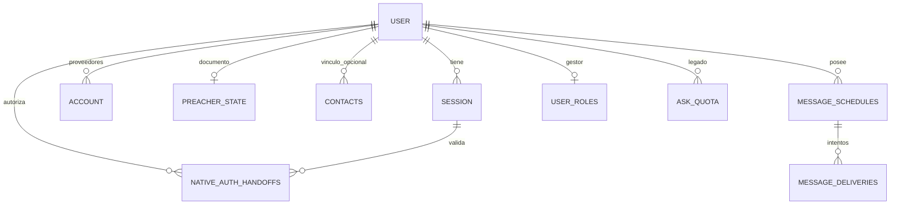

# Datos y contratos

Alcance: [árbol local revisado](contexto-tecnico.md). La fuente del esquema es `migrations/*.sql`, con modificaciones acumuladas; no basta leer la primera migración.

## Modelo de persistencia

`USER` representa la tabla SQL `"user"`, no una organización. `contacts.user_id` es nullable. Las referencias de usuario añadidas a estado, cuota y roles son `NOT VALID` para permitir filas históricas; nuevas escrituras sí se controlan. `user_roles.granted_by` es texto y se anonimiza en el trigger de eliminación.

| Tabla | Clave / contenido | Vida y acceso |
| --- | --- | --- |
| `user` | ID, nombre, email único, verificación, imagen, fechas | Better Auth; eliminación raíz |
| `session` | Token único, expiración, usuario, IP/agente | Better Auth; cascade |
| `account` | Proveedor/cuenta, usuario, tokens o hash de contraseña | Servidor; OAuth cifrado según configuración auth |
| `verification` | Identificador, valor, expiración | Better Auth; trigger limpia valores coincidentes con usuario |
| `preacher_state` | `user_id` PK, `payload` texto JSON, fecha | Documento completo por cuenta, upsert |
| `contacts` | ID serial, nombre/email/teléfono/dirección/locale, usuario opcional | Registro público; email único sin distinguir mayúsculas |
| `message_schedules` | ID, usuario, copia destinatario, canal, contenido/tema/idioma/firma, días/hora/zona, consentimiento, activo, próxima ejecución, lease | Solo usuario propietario; borrado en cascada |
| `message_deliveries` | ID, horario, ocurrencia, estado interno, SID/error y estado/error proveedor | Único `(schedule_id, scheduled_for)`; cascade del horario |
| `user_roles` | Usuario PK, `manager`, quién lo nombró | Propietario asigna; overview de gestor enmascarado |
| `form_throttle` | Hash con salt y fecha | Limita formulario; limpieza >24 h al usarlo |
| `native_auth_handoffs` | Hash código PK, challenge, cookie cifrada, sesión/usuario, expiración | 2 minutos, consumo atómico; purga por cron/emisión |
| `api_bible_budget` | `period` PK, llamadas, timestamps, bloqueo | Fila `rolling`, ventana 31 días; compartida |
| `api_bible_cache` | Clave Biblia/libro/capítulo, JSON, expiración, lease/token | 28 días; lease 30 s; servidor |
| `theme_verses` | `(theme_id, verse_id)`, referencia, fecha | Extras públicos; operaciones editoriales protegidas |
| `verse_texts` | `(verse_id, locale)`, referencia/texto/fuente/fecha | Legado vaciado por migración LBLA; ruta residual detectada |
| `verse_notes` | ID, verso/idioma/posición únicos, nota <=300, fecha | Notas históricas; fallback posible |
| `daily_reflections` | `(day, locale)`, verso y texto | Histórico compartido; nueva generación deshabilitada |
| `daily_blessings` | `(day, locale)`, texto | Histórico o bendición preparada; generación deshabilitada |
| `ask_quota` | `(user_id, day)`, contador | Infraestructura IA histórica; no habilita endpoints |
| `_migrations` | Nombre PK, fecha | Registro de esquema aplicado |

## Documento personal y dispositivo

`CloudPayload` en `store.ts` contiene favoritos, clasificación de favoritos, `verseMemory` por referencia, mensajes guardados, nombre de firma, notificaciones/hora, destinatarios, iglesia, historial manual, fecha/offset diario, posición, marcadores, resaltados, escala e idioma.

`Recipient` tiene ID, nombre, teléfono, temas, idioma/canal, notas, configuración diaria/culto y últimas fechas manuales. `ChurchInfo` es una configuración en el mismo documento. No hay tablas individuales de destinatarios o iglesias ni transacciones parciales para cada elemento.

El dispositivo conserva además idioma, color, testamento elegido, marcas de avisos y conversación histórica (`preacher-ask`). `chapterMemory` es un Map en memoria con expiración, no una descarga offline. iOS tiene otro archivo `readings.json` con UUID/título/texto/source/fecha, independiente de cuenta y nube.

## Rutas explícitas

| Ruta | Método / acceso | Resultado |
| --- | --- | --- |
| `/`, `/login`, `/privacy`, `/terms`, `/support` | Páginas | Shell o página específica |
| `/api/auth/$` | Handler Better Auth | Sesión, credenciales, proveedores, eliminación |
| `/api/auth-status` | GET público | Estado de configuración, no credenciales |
| `/api/native-auth/start` | GET; intent state/challenge/proveedor validado | Inicia OAuth de sistema |
| `/api/native-auth/complete` | GET; intención y sesión verificadas | Callback al esquema nativo con código temporal |
| `/api/native-auth/exchange` | POST; código/verifier | Consume código y devuelve cookie validada para WKWebView |
| `/api/ask`, `/api/compose` | POST | 403 `bible_ai_not_licensed` en edición actual |
| `/api/cron/messages` | GET; Bearer `CRON_SECRET` | Purga, procesa hasta 10 horarios si habilitado; conteos |
| `/api/twilio/status` | POST form; firma Twilio | Actualiza estado conocido; 204 válido / 403 firma inválida |

No crear rutas REST ficticias para las server functions: TanStack genera su transporte. Los nombres siguientes son sus contratos de código.

## Server functions del producto

| Módulo | Funciones | Autorización y semántica |
| --- | --- | --- |
| `recobro.ts` | `fetchRecobroChapter` | Pública; valida libro/capítulo; devuelve capítulo con copyright, expiry y FUMS; no-store |
| `user-state.ts` | `getMyState`, `saveMyState` | Sesión; filtra `context.userId`; normaliza snapshot |
| `contacts.ts` | `submitContact` | Pública; validación/consentimiento/throttle; respuesta no enumera email |
| `message-schedules.ts` | `getMessageSchedules`, `saveMessageSchedule`, `deleteMessageSchedule`, `setMessageScheduleEnabled` | Sesión + propietario; activar revisa conexión y consentimiento |
| `admin.ts` | `getAdminStatus`, `getAdminOverview`, `setManager` | Status por sesión; overview staff; asignación solo propietario |
| `admin-notes.ts` | `getVerseNotesStatus`, `prepareVerseNotes`, `resetVerseNotes` | Propietario; preparación tiene efecto previo al bloqueo IA, ver hallazgo H1 |
| `theme-verses.ts` | `getThemeExtras` | Pública; devuelve referencias; error retorna lista vacía |
| `theme-verses.ts` | `getThemeExtrasStatus`, `proposeThemeVerses`, `publishThemeVerses`, `removeThemeVerse` | Propietario; proponer/publicar bloqueados por política actual; quitar sigue posible |
| `daily-reflection.ts` | `getDailyReflection` | Pública; fecha dentro de 36 h; histórico/fallback sin generar |
| `daily-blessing.ts` | `getDailyBlessing` | Pública; fecha dentro de 36 h; histórico/preparado sin generar |
| `concordance-fn.ts` | `searchConcordance` | Devuelve indisponibilidad, no búsqueda global activa |

## Integraciones y datos salientes

| Destino | Información | Disparador |
| --- | --- | --- |
| API.Bible | Bible ID/capítulo y clave servidor | Caché ausente/vencida y presupuesto disponible |
| FUMS | Token/ID de lectura del proveedor | Render de contenido con atribución; no se agrega email/contactos |
| Google/Apple | Datos OAuth y sesión según proveedor | Inicio de sesión elegido por usuario |
| Twilio | Teléfono, destinatario, texto/referencia, plantilla y callback | Ocurrencia válida de programación activa |
| FormSubmit | Datos de nuevo registro, fecha/origen | Nuevo registro y `CONTACTS_EMAIL` configurado |
| Apps de compartir | Contenido seleccionado/referencia/nota | Acción manual del usuario |
| DeepSeek | Ninguna llamada generativa permitida por los guardas actuales | No activo; código y cachés históricos permanecen |

Las copias externas tienen ciclos de vida propios. La eliminación SQL no borra automáticamente correos recibidos, mensajes ya entregados ni notas nativas. La política de privacidad y la ficha App Privacy deben reflejar los servicios finalmente habilitados.
