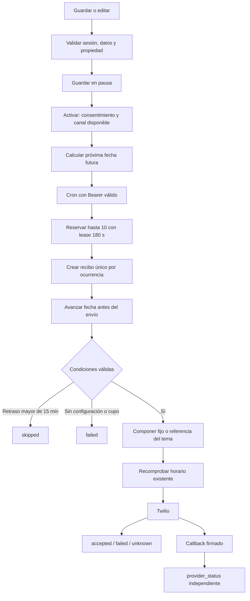

# Flujos de ejecución

Estos recorridos se derivan del código local; los pasos externos siguen sujetos a configuración y prueba real. Véanse [contratos](datos-y-contratos.md) y [hallazgos](revision-y-rediseno.md).

## F1. Abrir la aplicación y recuperar estado

```mermaid
sequenceDiagram
  participant U as Persona
  participant A as AppShell
  participant S as Sesión
  participant C as CloudSync
  participant D as PostgreSQL
  U->>A: Abre /
  A->>S: Resolver identidad
  S-->>A: Invitado o userId verificado
  A->>C: Cargar estado
  alt Invitado
    C->>C: Leer preacher-guest-state y quitar texto persistido
  else Cuenta
    C->>D: getMyState con sesión
    alt Nube vacía y trabajo de invitado
      C->>D: Guardar trabajo adoptado
      D-->>C: Confirmación
      C->>C: Limpiar invitado
    else Nube con trabajo
      D-->>C: Snapshot personal
    end
  end
  C-->>A: ready; renderizar sección
  U->>A: Cambia favorito o persona
  A->>C: Snapshot sin texto bíblico
  C->>D: Guardado diferido y serializado
```

Carga >15 s o fallo: aviso con reintento; no guardar un estado vacío encima de la cuenta. Fallo de escritura: reintentos limitados y estado `saveFailed`. Cambiar identidad detiene el saver anterior sin un guardado final accidental. Dos dispositivos no tienen resolución automática de conflictos. Fuentes: `app-shell.tsx`, `cloud-sync.tsx`, `cloud-saver.ts`, `user-state.ts`.

## F2. Leer un capítulo o abrir una referencia

```mermaid
sequenceDiagram
  participant V as BibleView / VerseCard
  participant M as chapterMemory
  participant S as Backend LBLA
  participant D as PostgreSQL
  participant P as API.Bible
  V->>M: loadCachedChapter / hydrateVerse
  alt Entrada viva en memoria
    M-->>V: Capítulo vigente
  else Ausente o vencida
    M->>S: fetchRecobroChapter
    S->>S: Validar libro y capítulo
    S->>D: Consultar caché compartida
    alt Caché vigente
      D-->>S: Payload y expiración
    else Falta contenido vigente
      S->>D: Reservar lease y llamada atómica
      alt Presupuesto disponible
        S->>P: GET capítulo; timeout 12 s
        P-->>S: JSON, copyright, metadatos
        S->>S: Validar Biblia/capítulo/copyright y parsear
        S->>D: Guardar por 28 días y liberar lease
      else Agotado o bloqueado
        S-->>V: Error recuperable de límite
      end
    end
    S-->>M: Capítulo con expiresAt
    M-->>V: Texto y atribución
  end
  V->>V: Mostrar copyright y reportar FUMS
```

No se devuelve contenido vencido ante fallo. 429 bloquea nuevos intentos durante 31 días; errores/timeout también consumen la reserva. Solicitudes simultáneas del proceso comparten Promise. Entre procesos se usa lease; no hay espera automática del resultado ajeno. La caché del servidor es independiente del idioma de interfaz.

**Excepción actual a la carga bajo demanda:** después del capítulo elegido, `BibleView` solicita el vecino anterior y siguiente. `prefetchVerses` está vacío, pero no elimina esa precarga. Los componentes revisan expiración en intervalo/foco según su implementación. No confundir ello con una descarga completa ni con una garantía de eliminación inmediata en un dispositivo suspendido.

Favorito/resaltado/marcador guarda IDs y referencias; al volver a abrir se hidrata texto vigente. Referencia histórica imposible de resolver: aviso de versión retirada y búsqueda por referencia. Selecciones no contiguas producen un ID/rango compuesto; su recuperación es un pendiente H7.

## F3. Hoy, temas y guías

1. Hoy calcula fecha local y referencia determinista; “Otro” cambia offset y el tema/ánimo puede cambiar la lista.
2. `VerseCard` hidrata la lectura y muestra estado de carga, contenido con copyright o error/reintento.
3. Bendición: saludo local más texto histórico/preparado. Reflexión: histórico válido o nota preparada; puede no aparecer. No se genera nueva IA.
4. Temas obtiene catálogo y extras; abre tarjetas. Doctrina/casos localizan la guía y enlazan pasajes.
5. Compartir guía compone explicación/referencias; no debe confundirse con compartir una cita LBLA completa.

Fuentes: `today-view.tsx`, `themes-view.tsx`, `evangelismo-view.tsx`, `verses.ts`, `daily-*.ts`, `doctrine.ts`, `preach-cases.ts`.

## F4. Compartir manualmente

Seleccionar lectura → `SendDrawer` → hidratar si hace falta → elegir nota/tipo/idioma/destinatario → `formatVerseMessage` → WhatsApp/SMS/correo/copia/hoja del sistema.

Con copyright LBLA, el formato saliente contiene referencia/fuente/enlace y nota/firma opcional. Imagen/impresión de lectura licenciada está deshabilitada. Compartir una nota propia o guía sigue un camino distinto. El historial manual guarda la acción; no confirma que la persona pulsó enviar en WhatsApp ni que el destinatario lo recibió. `tryNativeShare` trata cancelación como manejada para no abrir un fallback no deseado.

## F5. Gente y recordatorios

Alta manual o importación compatible → normalizar teléfono → actualizar coincidencia por ID/teléfono o insertar → persistir snapshot. Quitar pide confirmación y permite deshacer si no se llenó el cupo ni apareció el mismo teléfono.

`allDueItems` combina pendientes diarios por hora local y culto dentro de su ventana. El usuario abre el envío manual; la app registra la fecha correspondiente. Habilitar avisos solicita permiso y usa service worker/temporizador de página. No crea un registro de `message_schedules` ni un push de servidor.

## F6. Programar, procesar y confirmar resultado



Guardar no envía. Editar pausa. Activar calcula futuro sin recuperar el pasado. Zonas IANA y DST se resuelven con Temporal; no son la hora del servidor ni necesariamente la del teléfono.

Una ocurrencia incierta no se reenvía automáticamente para evitar duplicados. Al terminar se libera lease; un proceso interrumpido deja resultado `unknown`. La comprobación de existencia previa a Twilio reduce el riesgo de enviar tras eliminar cuenta, pero no puede retirar un request ya recibido por el proveedor.

Callback: valida firma contra URL pública fija, reconoce SID conocido y evita retroceder estado según su orden interno. Un callback que llega antes de guardar el SID puede ignorarse; no existe reconciliación periódica identificada. `accepted` interno y `delivered` de proveedor son campos diferentes. El estado `read` no está en la lista admitida.

Fuentes: `message-schedule.ts`, `schedules.server.ts`, `worker.server.ts`, `theme-delivery.server.ts`, `provider.server.ts`, `delivery-status.ts`.

## F7. Registro y administración

Formulario público → honeypot → validación/consentimiento → throttle por hash → inserción sin reemplazar email repetido → copia opcional FormSubmit solo si es nuevo → respuesta uniforme.

Admin resuelve staff en servidor y devuelve overview. Gestor recibe datos enmascarados; propietario recibe completos y puede asignar gestores. Importar un registro a Gente crea una copia personal; no crea cuenta ni autorización de mensajería por sí mismo. Las herramientas editoriales históricas de frases/temas tienen guardas IA y efectos residuales descritos en H1.

## F8. Autenticación iOS

```mermaid
sequenceDiagram
  participant W as WKWebView
  participant N as NativeAuthController
  participant O as Navegador de sistema
  participant S as Backend / Better Auth
  participant P as Google o Apple
  W->>N: preacherAuth desde origen/frame autorizado
  N->>N: Crear state, verifier y challenge S256
  N->>O: Abrir native-auth/start
  O->>S: Intento válido
  S->>P: OAuth
  P-->>S: Callback verificado
  S->>S: Emitir código temporal con cookie cifrada
  S-->>N: thepreacher callback con código/state
  N->>S: POST exchange(code, verifier)
  S->>S: Consumir código; validar sesión/expiración
  S-->>N: Cookie de sesión
  N->>W: Validar e instalar cookie; recargar
```

Cancelación o error no debe sustituir una sesión válida por estado vacío. Código repetido, expirado o con prueba incorrecta falla. Correo/contraseña usa el flujo web dentro de WKWebView. El recorrido real con Apple/Google y firma de dispositivo sigue pendiente.

## F9. Eliminar cuenta y conservar fronteras de datos

Perfil → confirmación explícita → contraseña o sesión social reciente → Better Auth → revocar Apple si corresponde → eliminar usuario y ejecutar trigger/cascadas → limpiar identidad/estado web → recargar con confirmación de éxito.

Fallo de autenticación/revocación: mensaje y datos conservados. La operación elimina programaciones y recibos de esa cuenta; no puede deshacer mensajes ya enviados. El archivo nativo de notas no está conectado a esta eliminación. Los registros públicos antiguos sin propiedad verificada requieren un procedimiento de soporte.

## F10. Nota nativa

Nueva nota → título/texto propio → validar longitudes → escritura atómica protegida → actualizar lista observable → buscar/leer/compartir/borrar. Un fallo de disco mantiene el estado previo. Archivo corrupto no se sobrescribe; falta un flujo de recuperación/exportación del archivo. Todo este flujo puede funcionar sin red, pero no proporciona lectura offline de LBLA.
